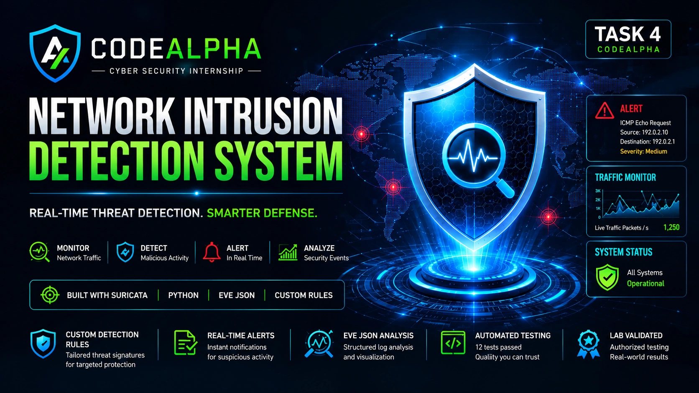
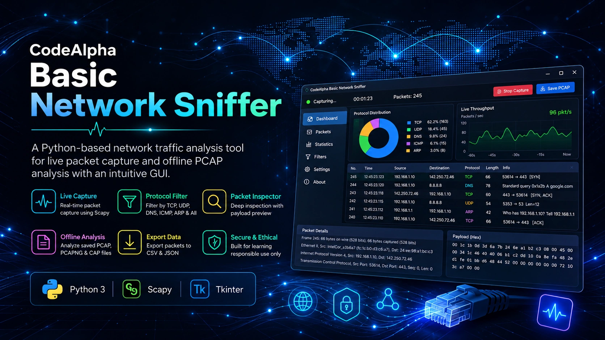

# Subhadeep Adhikary

  <strong>B.Tech CSE (IoT-CS-BCT) · Software Developer · AI &amp; Cybersecurity</strong> 
  Personal portfolio website for software development, AI exploration, cybersecurity, web development, and creative technology.

  <a href="https://subhadeep1357.github.io/my-portfolio/"><strong>LIVE PORTFOLIO</strong></a>
  &nbsp;·&nbsp;
  <a href="https://github.com/SuBhAdEeP1357">GitHub</a>
  &nbsp;·&nbsp;
  <a href="https://www.linkedin.com/in/subhadeepadhikary">LinkedIn</a>
  &nbsp;·&nbsp;
  <a href="mailto:iot23.subhadeepadhikary.31@gmail.com">Email</a>

  

  
  
  
  

---

## About

This repository contains my personal portfolio website. It brings together selected software and cybersecurity projects, AI interests, skills, internship experience, certifications, education, and contact links in one place.

The site uses a black foundation with white and gold accents. Reusable React components and shared data modules keep the desktop and compact experiences consistent while allowing their layouts and navigation to respond to device mode.

## Design Philosophy

The implementation favors a restrained visual system, readable content hierarchy, and responsive layouts. GSAP is used for selected section and dialog motion; animation code includes reduced-motion handling. Content such as projects and credentials is maintained in shared data sources and presented through reusable components.

## Features

- Device-aware desktop and compact layouts, including portrait tablet behavior
- Project cards, a project archive, detail dialogs, and screenshot galleries
- Skills, experience, contact, and certification sections with certificate archive and previews
- Responsive navigation and keyboard-aware dialog interactions with focus management
- Reduced-motion handling and lazy loading for selected images
- Search metadata, Open Graph and Twitter cards, and JSON-LD structured data

## Tech Stack

| Area | Technologies |
| --- | --- |
| Frontend | React, JavaScript, JSX, HTML, CSS |
| Build and development | Vite, npm, Node.js |
| Motion | GSAP, ScrollTrigger |
| Icons | React Icons |
| Linting | Oxlint |
| Type | Inter and JetBrains Mono font files |

The font files include their respective Open Font License notices in the repository.

## Featured Projects

  
  
  

### KIBO AI

**In development · 2026**

An AI-focused project in active development, aiming to build a practical and personalized intelligent system.

**Technologies:** Python, Artificial Intelligence, Machine Learning, Natural Language Processing  
The project data does not list a public repository or live demo.

### Network Intrusion Detection System

**Completed · 2026**

A Python-based network intrusion detection system built around Suricata, PCAP analysis, custom rules, and EVE JSON processing.

**Technologies:** Python, Suricata, Npcap, PCAP, YAML, pytest, Git, GitHub  
[View repository](https://github.com/SuBhAdEeP1357/CodeAlpha_NetworkIntrusionDetectionSystem)

### Basic Network Sniffer

**Completed · 2026**

A Python and Scapy packet sniffer for capturing, inspecting, filtering, and exporting live network traffic.

**Technologies:** Python, Scapy, Tkinter, PCAP, CSV, JSON  
[View repository](https://github.com/SuBhAdEeP1357/CodeAlpha_BasicNetworkSniffer)

### Secure Coding Review

**Completed · 2026**

A Python-focused code review project using static analysis to identify security issues, apply remediation, and validate changes with regression testing.

**Technologies:** Python, Bandit, Static Analysis  
[View repository](https://github.com/SuBhAdEeP1357/CodeAlpha_SecureCodingReview)

### Arithmetic Calculator

**Completed · 2026**

A modular, menu-driven C calculator for common arithmetic, mathematical, and utility operations.

**Technologies:** C, GCC, Modular Programming, Git, GitHub  
[View repository](https://github.com/SuBhAdEeP1357/Arithmetic-Calculator)

## Skills

| Area | Portfolio-listed skills |
| --- | --- |
| Programming | C, Python, JavaScript |
| Web development | HTML5, CSS3, JavaScript |
| Cybersecurity | Scapy, Suricata, Nmap |
| Development tools | Git, GitHub, Visual Studio Code |
| Database and framework | SQLite, Flask, MySQL |
| Creative tools | FL Studio, Adobe Express, Microsoft Clipchamp |

## Experience

### CodeAlpha — Cybersecurity Intern

**Remote · August 2026 – September 2026**

The portfolio describes practical cybersecurity project work involving networking, traffic analysis, and security-focused development.

Project work listed in the portfolio:

- **Basic Network Sniffer:** capturing, inspecting, filtering, and exporting live network traffic
- **Secure Coding Review:** Python static analysis, remediation, and validation
- **Network Intrusion Detection System:** Suricata, PCAP analysis, custom rules, and EVE JSON processing

## Certifications

| Credential | Issuer | Date |
| --- | --- | --- |
| Cybersecurity Internship Certificate | CodeAlpha | August–September 2026 |
| Gen AI Tools | IT-ITeS Sector Skill Council · NASSCOM | August 2026 |
| Foundations of Cybersecurity | Google · Coursera | January 2024 |
| Cybersecurity Analyst Job Simulation | Forage · TCS | July 2025 |
| Generative AI Essentials | TCS iON | September 2026 |

## Education

**B.Tech CSE (IoT-CS-BCT)**  
Asansol Engineering College · 2023–2027  
6th Semester SGPA: **8.10 / 10**

## Run Locally

**Requirements:** Node.js 20.19 or later and npm 10.8 or later.

From the repository root:

~~~sh
npm ci
npm run dev
~~~

Create a production build or run the repository linter with:

~~~sh
npm run build
npm run lint
~~~

## Supabase Contact Integration

The existing Contact form sends submissions to the `submit-contact` Supabase Edge Function. The function validates and sanitizes each message, applies a best-effort server-side rate limit, stores it in `public.contact_messages`, then attempts a notification through Resend. A successful database insert remains a successful form submission even if notification delivery is unavailable; the function response reports `notification` as `sent`, `failed`, or `not_configured`. Visitors do not need an account, and browser clients have no table permissions.

### Frontend environment

Copy `.env.example` to `.env` and fill in the project URL and publishable key from the Supabase project settings:

~~~dotenv
VITE_SUPABASE_URL=
VITE_SUPABASE_PUBLISHABLE_KEY=
~~~

These values are used by the browser client. Never put a Supabase secret key or Resend key in a `VITE_` variable or any frontend file.

Set the same two values in the environment that runs the production Vite build. They are public browser configuration; the publishable key is intended for client use and is restricted by database grants and RLS.

### Database and Edge Function

The reproducible migration is `supabase/migrations/20261008000000_create_contact_messages.sql`. It creates the table, enables RLS, revokes browser access, and grants the Edge Function's server-side role only the insert privilege it needs. There are no public read, update, or delete policies.

After installing the Supabase CLI and linking this checkout to the existing project, apply the migration and deploy the function with:

~~~sh
supabase login
supabase link --project-ref <project-ref>
supabase db push
supabase functions deploy submit-contact
~~~

`supabase/config.toml` disables the legacy gateway JWT check for this function; its current `@supabase/server` wrapper validates the publishable key sent by `supabase-js`. The function CORS allowlist includes the current GitHub Pages origin and local Vite origins on ports 5173–5199.

### Resend setup

In Supabase Dashboard → Edge Functions → Secrets, configure these server-only secrets:

- `RESEND_API_KEY` — a Resend sending key
- `RESEND_FROM_EMAIL` — an address on a verified Resend domain
- `CONTACT_NOTIFICATION_EMAIL` — the mailbox that receives portfolio messages

The function sends a fixed-subject notification, with the validated visitor email as `reply_to`. It escapes message values in the HTML email. No visitor acknowledgement is sent. Resend credentials and sender-domain verification must be configured before production submissions can complete.

The rate limiter allows up to five requests per 15 minutes for each request IP and normalized email. Its counters live in the Edge Function isolate, so they are best-effort and are not shared across concurrently running instances; the honeypot and server-side validation provide additional basic spam protection.

The Edge Function tests can run on Node.js 24 with:

~~~sh
node --experimental-strip-types --test supabase/functions/tests/submit-contact/index.test.ts
~~~

The database access assertions in `supabase/tests/contact_messages_access.sql` run with `supabase test db` after the local Supabase stack is available.

## Project Structure

~~~text
PORTFOLIO/
├── public/                 # Site metadata files, favicons, and social preview
├── src/
│   ├── assets/             # Images, branding, icons, and fonts
│   ├── components/         # Reusable desktop and compact UI sections
│   ├── data/               # Projects, skills, experience, credentials, and links
│   ├── hooks/
│   ├── lib/                # Browser Supabase client
│   ├── styles/
│   ├── App.jsx
│   ├── DesktopApp.jsx
│   ├── MobileApp.jsx
│   ├── main.jsx
│   └── *.css
├── supabase/
│   ├── functions/          # submit-contact and shared utilities
│   └── migrations/         # Reproducible database schema and access rules
├── index.html
├── package.json
├── package-lock.json
├── vite.config.js
├── LICENSE
└── README.md
~~~

## Contact

- **GitHub:** [SuBhAdEeP1357](https://github.com/SuBhAdEeP1357)
- **LinkedIn:** [subhadeepadhikary](https://www.linkedin.com/in/subhadeepadhikary)
- **Instagram:** [subhadeepadhikaryofficial](https://www.instagram.com/subhadeepadhikaryofficial)
- **Email:** [iot23.subhadeepadhikary.31@gmail.com](mailto:iot23.subhadeepadhikary.31@gmail.com)

## License

The website source code is licensed under the MIT terms in [LICENSE](LICENSE). Portfolio media, branding, and personal content are reserved and are not covered by that MIT grant. Third-party materials retain their respective licenses and rights.

